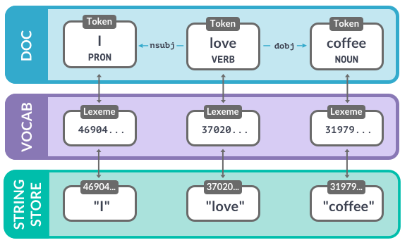

# spaCy – notatki (kurs „Advanced NLP with spaCy”, Chapter 2)

1. [Data Structures (1): Vocab, Lexemes, StringStore](#1-data-structures-1-vocab-lexemes-stringstore)
2. [Data Structures (2): Doc, Span, Token](#2-data-structures-2-doc-span-token)
3. [Word vectors and semantic similarity](#3-word-vectors-and-semantic-similarity)
4. [Combining predictions and rules](#4-combining-predictions-and-rules)

---

## 1. Data Structures (1): Vocab, Lexemes, StringStore

### Vocab i StringStore

```python
import spacy

nlp = spacy.blank("en")

# hash napisu, którego słownik jeszcze nie widział -> BŁĄD (KeyError E018)
# string = nlp.vocab.strings[3197928453018144401]

nlp.vocab.strings.add("coffee")                 # dodanie napisu do StringStore
doc = nlp("I love coffee")                      # przetworzenie tekstu też dodaje słowa do vocab

print("hash value:", nlp.vocab.strings["coffee"])               # napis -> hash
print("string value:", nlp.vocab.strings[3197928453018144401])  # hash -> napis
print("hash value:", doc.vocab.strings["coffee"])               # Doc też ma vocab i strings
```
```
hash value: 3197928453018144401
string value: coffee
hash value: 3197928453018144401
```

| Co | Do czego |
|---|---|
| `nlp.vocab` (`Vocab`) | wspólne dane dla wielu dokumentów: słowa, ale też schematy etykiet tagów i jednostek |
| `nlp.vocab.strings` (`StringStore`) | tabela w obie strony: napis → hash, hash → napis |
| `nlp.vocab.strings.add("coffee")` | dodanie napisu do StringStore |
| `doc.vocab.strings` | to samo, dostępne z obiektu `Doc` |

- Żeby oszczędzać pamięć, spaCy zamienia wszystkie napisy na **hashe**.
- Napisy są zapisywane **tylko raz** w `StringStore` (`nlp.vocab.strings`).
- StringStore to **tabela wyszukiwania w obie strony** (lookup table).

### Lexeme – wpis w słowniku

```python
doc = nlp("I love coffee")

lexeme = nlp.vocab["coffee"]                    # Lexeme po napisie
print(lexeme.text, lexeme.orth, lexeme.is_alpha)

lexeme = nlp.vocab[3197928453018144401]         # albo po hashu
print(lexeme.text, lexeme.orth, lexeme.is_alpha)
```
```
coffee 3197928453018144401 True
coffee 3197928453018144401 True
```

| Co | Do czego |
|---|---|
| `nlp.vocab["coffee"]` / `nlp.vocab[hash]` | pobranie `Lexeme` po napisie albo po hashu |
| `lexeme.text` | tekst słowa |
| `lexeme.orth` | hash słowa |
| `lexeme.is_alpha` | atrybut leksykalny (Lexeme ma atrybuty tak jak token) |

- Obiekt `Lexeme` to **wpis w słowniku** (vocabulary).
- Zawiera informacje o słowie **niezależne od kontekstu**:
  - tekst słowa: `lexeme.text` i `lexeme.orth` (hash),
  - atrybuty leksykalne, np. `lexeme.is_alpha`,
  - **nie** zawiera zależnych od kontekstu części mowy, zależności ani etykiet jednostek.



---

## 2. Data Structures (2): Doc, Span, Token

```python
import spacy
from spacy.tokens import Doc, Span

nlp = spacy.blank("en")

words = ["Hello", "world", "!"]
spaces = [True, False, False]                # czy po słowie jest spacja (także dla ostatniego!)
doc = Doc(nlp.vocab, words=words, spaces=spaces)   # Doc ręcznie: vocab + słowa + spacje

span = Span(doc, 0, 2)                       # Span ręcznie: doc, start, end (end wyłączony)
span_with_label = Span(doc, 0, 2, label="GREETING")  # + opcjonalna etykieta

doc.ents = [span_with_label]                 # doc.ents można nadpisać listą spanów

print(doc.text)
print(span.text)
for ent in doc.ents:
    print(ent.text, ent.label_)
```
```
Hello world!
Hello world
Hello world GREETING
```

| Co | Do czego |
|---|---|
| `from spacy.tokens import Doc, Span` | klasy do ręcznego tworzenia obiektów |
| `Doc(vocab, words=..., spaces=...)` | 3 argumenty: wspólny vocab, lista słów, lista `True/False` (spacja po słowie) |
| `Span(doc, start, end, label=...)` | doc, indeks początku, indeks końca, opcjonalna etykieta |
| `doc.ents = [...]` | ręczne ustawienie jednostek nazwanych (dowolny iterowalny zbiór obiektów `Span`) |

`Doc` powstaje automatycznie po `nlp(tekst)`, ale klasę można też utworzyć ręcznie.

**Dobre praktyki:**
- `Doc` i `Span` są bardzo potężne i trzymają referencje i relacje między słowami i zdaniami:
  - **zamieniaj wynik na napisy jak najpóźniej**,
  - **używaj atrybutów tokenów, jeśli są dostępne**, np. `token.i` jako indeks tokena.
- Nie zapomnij przekazać **wspólnego `vocab`**.

---

## 3. Word vectors and semantic similarity

```python
import spacy

nlp = spacy.load("en_core_web_md")      # potrzebne wektory: md albo lg, NIE sm

doc1 = nlp("I like fast food")
doc2 = nlp("I like pizza")
print(doc1.similarity(doc2))            # Doc vs Doc

doc = nlp("I like pizza and pasta")
print(doc[2].similarity(doc[4]))        # Token vs Token: "pizza" vs "pasta"

span = doc[2:5]                         # Span "pizza and pasta"
print(span.similarity(nlp("McDonalds sells burgers")))   # Span vs Doc

print(nlp("I like pizza").similarity(nlp("soap")[0]))    # Doc vs Token

print(nlp("I have a banana")[3].vector) # wektor słowa "banana" (300 wymiarów)

print(nlp("I like cats").similarity(nlp("I hate cats")))
```
```
0.8627204117787385
0.7369546
0.619909235817623
0.32531983166759537
[2.02280000e-01, -7.66180009e-02, 3.70319992e-01, ...]
0.9501447503553421
```

| Co | Do czego |
|---|---|
| `spacy.load("en_core_web_md")` | potok z wektorami (md ≈ 20 000 wektorów słów; lg – duży) |
| `.similarity(inny_obiekt)` | jest w `Doc`, `Span`, `Token`; przyjmuje **jeden** argument i zwraca wynik od 0 do 1 |
| `token.vector` | wektor słowa |

- `Doc.similarity()`, `Span.similarity()` i `Token.similarity()` przyjmują inny obiekt i zwracają wynik podobieństwa (od `0` do `1`).
- **Ważne:** potrzebny jest potok z wektorami słów, np. `en_core_web_md` (medium), `en_core_web_lg` (large)

---

## 4. Combining predictions and rules

```python
import spacy
from spacy.matcher import Matcher, PhraseMatcher

nlp = spacy.load("en_core_web_sm")
doc = nlp("I have a Golden Retriever")

# Matcher + przewidywania modelu
matcher = Matcher(nlp.vocab)
matcher.add("DOG", [[{"LOWER": "golden"}, {"LOWER": "retriever"}]])

for match_id, start, end in matcher(doc):
    span = doc[start:end]
    print("Matched span:", span.text)
    print("Root token:", span.root.text)              # token decydujący o kategorii frazy
    print("Root head token:", span.root.head.text)    # „rodzic” składniowy całej frazy
    print("Previous token:", doc[start - 1].text, doc[start - 1].pos_)  # token przed dopasowaniem

# PhraseMatcher – wzorcem jest Doc, nie lista słowników
phrase_matcher = PhraseMatcher(nlp.vocab)
phrase_matcher.add("DOG", [nlp("Golden Retriever")])

for match_id, start, end in phrase_matcher(doc):
    print("Matched span:", doc[start:end].text)
```
```
Matched span: Golden Retriever
Root token: Retriever
Root head token: have
Previous token: a DET
Matched span: Golden Retriever
```

| Co | Do czego |
|---|---|
| `span.root` | główny token frazy (dla „Golden Retriever” → „Retriever”) |
| `span.root.head` | nadrzędnik składniowy frazy (tu czasownik „have”) |
| `doc[start - 1]` | token przed dopasowaniem i jego atrybuty |
| `PhraseMatcher(nlp.vocab)` | jak wyszukiwanie słów kluczowych, ale z dostępem do tokenów w kontekście |
| `phrase_matcher.add("ID", [nlp("tekst")])` | wzorce to obiekty `Doc`; API takie samo jak w `Matcher` |

PhraseMatcher:
- jako wzorce przyjmuje obiekty `Doc`,
- jest wydajniejszy i szybszy niż `Matcher`,
- świetny do dopasowywania dużych list słów.
