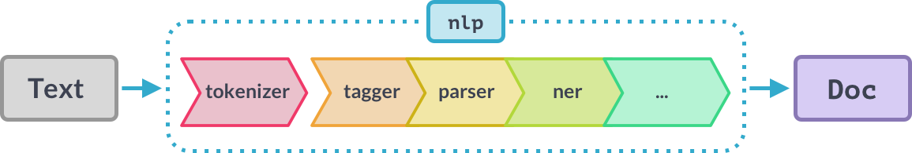

# spaCy – notatki (kurs „Advanced NLP with spaCy”, Chapter 3)

1. [Processing pipelines](#1-processing-pipelines)
2. [Custom pipeline components](#2-custom-pipeline-components)
3. [Extension attributes](#3-extension-attributes)
4. [Scaling and performance](#4-scaling-and-performance)

---

## 1. Processing pipelines



```python
import spacy

nlp = spacy.load("en_core_web_sm")      # ładuje język, pipeline i wagi modeli

doc = nlp("This is a sentence.")        # tokenizer -> komponenty po kolei -> gotowy Doc

print(nlp.pipe_names)                   # same nazwy komponentów
print(nlp.pipeline)                     # krotki (nazwa, komponent)
```
```
['tok2vec', 'tagger', 'parser', 'ner', 'attribute_ruler', 'lemmatizer']
[('tok2vec', <spacy.pipeline.Tok2Vec>),
 ('tagger', <spacy.pipeline.Tagger>),
 ('parser', <spacy.pipeline.DependencyParser>),
 ('ner', <spacy.pipeline.EntityRecognizer>),
 ('attribute_ruler', <spacy.pipeline.AttributeRuler>),
 ('lemmatizer', <spacy.pipeline.Lemmatizer>)]
```

Co się dzieje po `nlp(tekst)`:
1. **tokenizer** zamienia napis w obiekt `Doc` (zawsze jako pierwszy),
2. komponenty pipeline'u są stosowane do `Doc` **po kolei** (np. tagger → parser → ner),
3. zwracany jest przetworzony `Doc`.

**Wbudowane komponenty:**

| Nazwa | Opis | Tworzy |
|---|---|---|
| **tagger** | part-of-speech tagger | `Token.tag`, `Token.pos` |
| **parser** | dependency parser | `Token.dep`, `Token.head`, `Doc.sents`, `Doc.noun_chunks` |
| **ner** | named entity recognizer | `Doc.ents`, `Token.ent_iob`, `Token.ent_type` |
| **textcat** | text classifier | `Doc.cats` |

| Co | Do czego |
|---|---|
| `nlp.pipe_names` | lista nazw komponentów |
| `nlp.pipeline` | lista krotek `(nazwa, komponent)`; komponent to funkcja, która przetwarza doc i ustawia atrybuty |
---

## 2. Custom pipeline components

```python
import spacy
from spacy.language import Language

nlp = spacy.load("en_core_web_sm")

@Language.component("custom_component")      # rejestracja komponentu pod nazwą
def custom_component_function(doc):          # dostaje doc...
    print("Doc length:", len(doc))           # ...coś z nim robi...
    return doc                               # ...i MUSI go zwrócić

nlp.add_pipe("custom_component", first=True) # dodanie do pipeline'u (po nazwie)
print("Pipeline:", nlp.pipe_names)

doc = nlp("Hello world!")                    # komponent wykona się automatycznie
```
```
Pipeline: ['custom_component', 'tok2vec', 'tagger', 'parser', 'ner', 'attribute_ruler', 'lemmatizer']
Doc length: 3
```

| Co | Do czego |
|---|---|
| `from spacy.language import Language` | klasa z dekoratorem do rejestrowania komponentów |
| `@Language.component("nazwa")` | mówi spaCy, gdzie jest komponent i jak się nazywa |
| `nlp.add_pipe("nazwa")` | dodaje komponent; przyjmuje co najmniej nazwę (string) |
| `last=True` | dodaj na końcu (domyślnie) |
| `first=True` | dodaj na początku, zaraz po tokenizerze |
| `before="ner"` | dodaj przed wskazanym komponentem |
| `after="tagger"` | dodaj po wskazanym komponencie |

**Po co własne komponenty:**
- funkcja wykonuje się automatycznie po wywołaniu `nlp`,
- dodawanie własnych metadanych do dokumentów i tokenów,
- aktualizowanie wbudowanych atrybutów, np. `doc.ents`.

---

## 3. Extension attributes

```python
import spacy
from spacy.tokens import Doc, Token, Span    # globalne klasy

nlp = spacy.blank("en")

# 1) Attribute extension – wartość domyślna, którą można nadpisać
Token.set_extension("is_color", default=False)

# 2) Property extension – getter liczy wartość przy odczycie
def get_has_color(span):
    colors = ["red", "yellow", "blue"]
    return any(token.text in colors for token in span)

Span.set_extension("has_color", getter=get_has_color)

# 3) Method extension – funkcja jako metoda, z argumentami
def has_token(doc, token_text):              # 1. argument to zawsze sam obiekt
    return token_text in [token.text for token in doc]

Doc.set_extension("has_token", method=has_token)

doc = nlp("The sky is blue.")
doc[3]._.is_color = True                     # nadpisanie wartości dla "blue"

print(doc[3]._.is_color, "-", doc[3].text)
print(doc[1:4]._.has_color, "-", doc[1:4].text)
print(doc[0:2]._.has_color, "-", doc[0:2].text)
print(doc._.has_token("blue"), "- blue")
print(doc._.has_token("cloud"), "- cloud")
```
```
True - blue
True - sky is blue
False - The sky
True - blue
False - cloud
```

| Co | Do czego |
|---|---|
| `obj._.nazwa` | dostęp do własnego atrybutu; `._` pokazuje, że dodał go użytkownik, a nie spaCy (jak `token.text`) |
| `Doc/Token/Span.set_extension("nazwa", ...)` | rejestracja atrybutu na globalnej klasie; 1. argument to nazwa |
| `default=...` | attribute extension: wartość domyślna, można ją nadpisać |
| `getter=funkcja` | property extension: wartość liczona przy odczycie; getter dostaje jeden argument (obiekt) |
| `setter=funkcja` | opcjonalny setter dla property extension |
| `method=funkcja` | method extension: wywołanie `obj._.nazwa(arg)`; obiekt przekazywany automatycznie jako 1. argument |

**Typy rozszerzeń:**
1. **Attribute extensions** – ustawiają wartość domyślną, którą można nadpisać.
2. **Property extensions** – definiują getter i opcjonalny setter; getter wywoływany jest tylko przy *odczycie* wartości.
   - Rozszerzenia `Span` powinny prawie zawsze używać gettera (inaczej trzeba by ręcznie ustawić wartość dla każdego możliwego spana).
3. **Method extensions** – przypisują **funkcję**, która staje się metodą obiektu; pozwalają przekazać **argumenty**.

---

## 4. Scaling and performance

```python
import spacy
from spacy.tokens import Doc

nlp = spacy.load("en_core_web_sm")

# Dużo tekstów: nlp.pipe zamiast nlp w pętli
# ŹLE:   docs = [nlp(text) for text in LOTS_OF_TEXTS]
docs = list(nlp.pipe(LOTS_OF_TEXTS))        # generator -> list()

# Kontekst/metadane razem z tekstem
Doc.set_extension("id", default=None)
Doc.set_extension("page_number", default=None)

data = [
    ("This is a text", {"id": 1, "page_number": 15}),
    ("And another text", {"id": 2, "page_number": 16}),
]

for doc, context in nlp.pipe(data, as_tuples=True):   # (text, context) -> (doc, context)
    doc._.id = context["id"]
    doc._.page_number = context["page_number"]
    print(doc.text, context["page_number"])

# Tylko tokenizer
# ŹLE:   doc = nlp("Hello world")
doc = nlp.make_doc("Hello world!")

# Tymczasowe wyłączenie komponentów
with nlp.select_pipes(disable=["tagger", "parser"]):
    doc = nlp(text)                         # działa tylko reszta pipeline'u
    print(doc.ents)
# po bloku with tagger i parser wracają
```
```
This is a text 15
And another text 16
```

| Co | Do czego |
|---|---|
| `nlp.pipe(texts)` | przetwarza teksty strumieniowo (w paczkach), zwraca generator obiektów `Doc` |
| `list(nlp.pipe(...))` | lista docs (bo `nlp.pipe` to generator) |
| `nlp.pipe(data, as_tuples=True)` | wejście: krotki `(text, context)`, wyjście: krotki `(doc, context)` |
| `nlp.make_doc(text)` | tylko tokenizacja, zwraca `Doc`; tak samo spaCy robi to wewnętrznie przed komponentami |
| `nlp.select_pipes(disable=[...])` / `enable=[...]` | menedżer kontekstu (`with`): tymczasowo wyłącza / włącza komponenty po nazwach |

**Przetwarzanie dużych ilości tekstu:**
- używaj metody `nlp.pipe`,
- przetwarza teksty jako strumień i zwraca obiekty `Doc`,
- dużo szybsza niż wywoływanie `nlp` na każdym tekście.

**Przekazywanie kontekstu:**
- `as_tuples=True` w `nlp.pipe` pozwala przekazać krotki `(text, context)`,
- zwraca krotki `(doc, context)`,
- przydatne do powiązania metadanych z `doc`.
