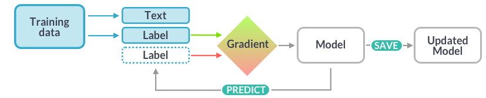

# spaCy – notatki (kurs „Advanced NLP with spaCy”, Chapter 4)

1. [Training and updating models](#1-training-and-updating-models)
2. [Configuring and running the training](#2-configuring-and-running-the-training)
3. [Best practices for training spaCy models](#3-best-practices-for-training-spacy-models)
4. [Wrapping up](#4-wrapping-up)

---

## 1. Training and updating models



```python
import random
import spacy
from spacy.tokens import Span, DocBin

nlp = spacy.blank("en")

# Doc z encją – przykład z kontekstem
doc1 = nlp("iPhone X is coming")
doc1.ents = [Span(doc1, 0, 2, label="GADGET")]
# Doc bez encji – też ważny
doc2 = nlp("I need a new phone! Any tips?")

docs = [doc1, doc2]  # i tak dalej...

# Podział: dane treningowe i ewaluacyjne (tu 50/50)
random.shuffle(docs)
train_docs = docs[:len(docs) // 2]
dev_docs = docs[len(docs) // 2:]

# Zapis do plików binarnych .spacy
train_docbin = DocBin(docs=train_docs)
train_docbin.to_disk("./train.spacy")
dev_docbin = DocBin(docs=dev_docs)
dev_docbin.to_disk("./dev.spacy")
```

```bash
# konwersja gotowych korpusów (.conll, .conllu, .iob, stary JSON spaCy)
python -m spacy convert ./train.gold.conll ./corpus
```

| Co | Do czego |
|---|---|
| `doc.ents = [Span(doc, start, end, label=...)]` | adnotacja encji w przykładzie treningowym (jak w Chapter 2) |
| `doc.ents = []` | przykład bez encji: model uczy się też, co **nie** jest encją |
| `random.shuffle` + slicing | podział na **training data** i **development data** |
| `DocBin(docs=...)` | kontener do wydajnego przechowywania obiektów `Doc` (wspólny vocab zapisany raz – szybszy i mniejszy niż `pickle`) |
| `docbin.to_disk("./train.spacy")` | zapis do pliku binarnego; rozszerzenie `.spacy` |
| `spacy convert` | zamiana korpusów w popularnych formatach na binarny format spaCy |

**Dlaczego aktualizować model:**
- lepsze wyniki w konkretnej dziedzinie,
- nauka schematów klasyfikacji specyficznych dla problemu,
- niezbędne dla klasyfikacji tekstu,
- bardzo przydatne dla rozpoznawania encji,
- mniej istotne dla tagowania części mowy i parsowania zależności.

**Trening entity recognizera:**
- entity recognizer taguje słowa i frazy w kontekście,
- każdy token może należeć tylko do jednej encji,
- przykłady muszą mieć kontekst,
- teksty bez encji też są ważne,
- **cel:** nauczyć model uogólniać.
- 
---

## 2. Configuring and running the training

```bash
# 1) wygenerowanie domyślnego configu
python -m spacy init config ./config.cfg --lang en --pipeline ner

# 2) trening
python -m spacy train ./config.cfg --output ./output --paths.train train.spacy --paths.dev dev.spacy

# 3) (opcjonalnie) paczka Pythona z pipeline'em
python -m spacy package /path/to/output/model-best ./packages --name my_pipeline --version 1.0.0
cd ./packages/en_my_pipeline-1.0.0
pip install dist/en_my_pipeline-1.0.0.tar.gz
```

```python
import spacy

nlp = spacy.load("/path/to/output/model-best")   # albo po instalacji: spacy.load("en_my_pipeline")
doc = nlp("iPhone 11 vs iPhone 8: What's the difference?")
print(doc.ents)
```

Fragment `config.cfg`:
```ini
[nlp]
lang = "en"
pipeline = ["tok2vec", "ner"]
batch_size = 1000

[nlp.tokenizer]
@tokenizers = "spacy.Tokenizer.v1"

[components]

[components.ner]
factory = "ner"

[components.ner.model]
@architectures = "spacy.TransitionBasedParser.v2"
hidden_width = 64
# And so on...
```

Wynik `spacy train` (fragment ze slajdu):
```
============================ Training pipeline ============================
ℹ Pipeline: ['tok2vec', 'ner']
ℹ Initial learn rate: 0.001

E    #       LOSS TOK2VEC  LOSS NER  ENTS_F  ENTS_P  ENTS_R  SCORE
---  ------  ------------  --------  ------  ------  ------  ------
  0       0          0.00     26.50    0.73    0.39    5.43    0.01
  0     200         33.58    847.68   10.88   44.44    6.20    0.11
  1     400         70.88    267.65   33.50   45.95   26.36    0.33
...
 13    1800        105.14     23.23   56.88   69.66   48.06    0.57

✔ Saved pipeline to output directory
/path/to/output/model-last
```

| Co | Do czego |
|---|---|
| `[nlp]`, `[components.ner.model]` | sekcje configu; zagnieżdżenie przez kropkę |
| `@tokenizers = ...`, `@architectures = ...` | odwołanie do zarejestrowanej funkcji Pythona (notacja `@`) |
| `init config` | komenda generująca config |
| `./config.cfg` | ścieżka wyjściowa configu |
| `--lang` | klasa języka, np. `en` |
| `--pipeline` | nazwy komponentów oddzielone przecinkami |
| `train ./config.cfg` | trening; 1. argument to ścieżka do configu |
| `--output` | katalog na wytrenowany pipeline |
| `--paths.train` / `--paths.dev` | nadpisanie w CLI ścieżek do danych treningowych / ewaluacyjnych |
| `E` / `#` | epoka (przejście po danych) / krok (wyniki co 200 przykładów) |
| `SCORE` | łączny wynik na danych ewaluacyjnych – najważniejsza kolumna |
| `model-last` / `model-best` | ostatni / najlepszy wytrenowany pipeline |
| `spacy package` | instalowalna paczka Pythona; do nazwy dodawany jest kod języka (`my_pipeline` → `en_my_pipeline`) |

**Training config:**
- **jedno źródło prawdy** dla wszystkich ustawień, zwykle `config.cfg`,
- definiuje, jak zainicjalizować obiekt `nlp`,
- zawiera ustawienia komponentów i ich modeli,
- konfiguruje proces treningu i hiperparametry,
- sprawia, że trening jest powtarzalny.

**Generowanie configu:** interaktywny [quickstart widget](https://spacy.io/usage/training#quickstart) w dokumentacji albo komenda [`init config`](https://spacy.io/api/cli#init-config).

**Trening:** potrzebne są tylko `config.cfg` oraz dane treningowe i ewaluacyjne; ustawienia configu można nadpisać w CLI. Trening trwa, aż model przestanie się poprawiać.

---

## 3. Best practices for training spaCy models

```python
# ŹLE:
LABELS = ["ADULT_SHOES", "CHILDRENS_SHOES", "BANDS_I_LIKE"]

# DOBRZE:
LABELS = ["CLOTHING", "BAND"]
```

| Problem | Rozwiązanie |
|---|---|
| **Model może „zapominać”** – istniejący model przeucza się na nowych danych, np. ucząc tylko `"WEBSITE"`, może „oduczyć się”, czym jest `"PERSON"` (*catastrophic forgetting*) | **Domieszaj wcześniej poprawne predykcje** – trenując `"WEBSITE"`, dodaj też przykłady `"PERSON"`; uruchom istniejący model na danych i wyciągnij pozostałe potrzebne encje |
| **Model nie nauczy się wszystkiego** – modele spaCy przewidują na podstawie **lokalnego kontekstu**; trudno, gdy decyzji nie da się podjąć z kontekstu; schemat etykiet musi być spójny i niezbyt szczegółowy (`"CLOTHING"` lepsze niż `"ADULT_CLOTHING"` i `"CHILDRENS_CLOTHING"`) | **Starannie zaplanuj schemat etykiet** – wybieraj kategorie widoczne w lokalnym kontekście; ogólniejsze lepsze niż zbyt szczegółowe; z ogólnych etykiet do szczegółowych kategorii przechodź regułami |


